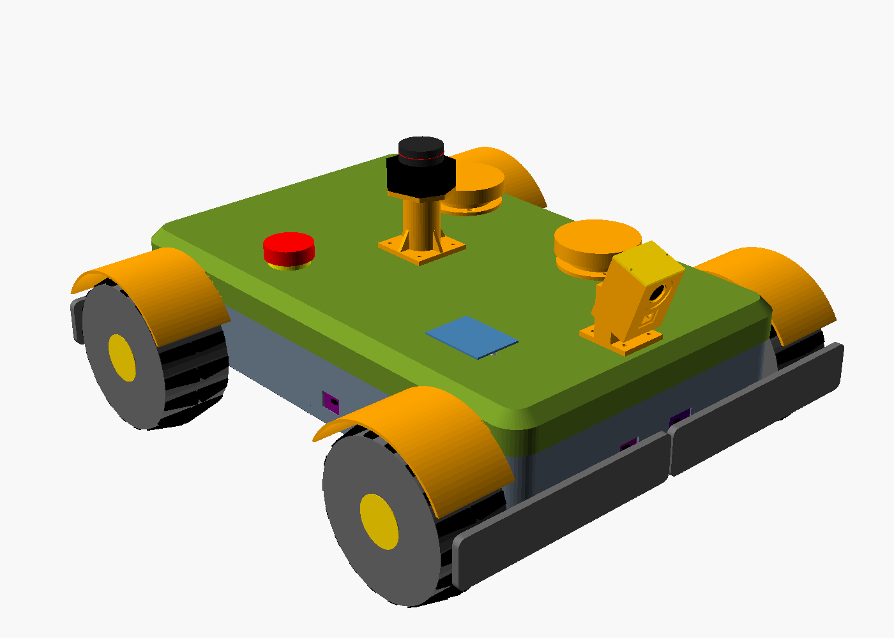
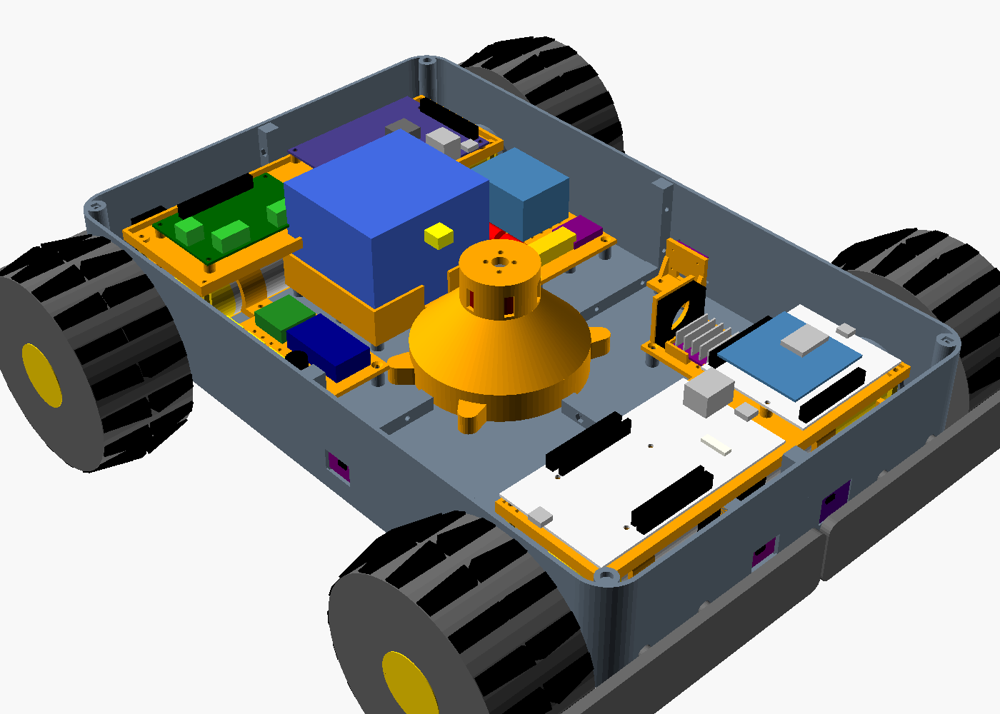

# GrassKit Rover chassis (OpenSCAD)

`grasskit_rover.scad` (v3) is a parametric model of the rover built from the final parts list, `documentation/00_Project_Status/GrassKit_Rover_Final_BOM_2026-11-04.xlsx`. The body is enclosed and fully 3D-printed. The model includes:

- a tub (floor and walls) and a lid, each printed as four quarters that bolt together;
- the parts that hold the drive, cutter, boards, battery and sensors;
- stand-ins for every bought part.

The OpenSCAD console prints a report:

- weight, centre of gravity, wheel loads and tip-over angles;
- drive torque and motor current, battery runtime;
- print-bed fit;
- warnings for parts that collide.



Open `grasskit_rover.scad` in OpenSCAD 2021.01 or newer. It pulls in the other two `.scad` files automatically.

| File | Holds |
|:---|:---|
| `grasskit_rover.scad` | Every setting (Customizer), the layout, the weight table, the report |
| `rover_printed_parts.scad` | The printed parts |
| `rover_bought_parts.scad` | Stand-ins for the wheels, motors, boards, battery, sensors and E-stop |
| `stl/` | The printed parts as STL files for the default settings |
| `renders/` | Pictures of the assembly |
| `v2_first_parts_list/` | v2: the same kind of body for the first parts list (75 mm mecanum, JGA25, RS-775, 4 x 18650, N6 only) |
| `grasskit_rover_v1_open_frame.scad` | v1: open frame (flat deck, canopy on posts) |
| `v1_3d_print_Chassis/` | The bench rover printed now: one-piece deck for the parts on hand (NUCLEO-L073RZ, RBT01, 4 TT motors, mecanum wheels, 18650 and AA holders) |

## Layout

Origin is on the ground under the middle of the wheelbase. +X is forward, +Y is left.

| Height above ground (mm) | What |
|---:|:---|
| 40 | Trimmer line (`cut_height`) |
| 52 | Floor underside (line + 12 mm) |
| 44 | Underside of the motor trays, the lowest point between the wheels |
| 65 | Wheel axles |
| 96 | Board decks |
| 122 | Tub rim |
| 142.5 | Lid top |
| ~215 | Top of the camera pod |
| 225 | Lidar scan plane, clear of the camera pod |

- **Body:**
  - 440 x 280 mm; 476 x 412 mm over the wheels and bumpers.
  - Wheelbase 320 mm. The cutter is at the centre.
  - The trimmer line sweeps a 200 mm circle that stays between the axles.
- **Drive:**
  - Each 36 mm gearmotor lies on the floor, bolted by its gearbox face to a 6 mm pad on the side wall.
  - Its lower edge drops through a floor slot into a printed tray under the floor.
  - A printed clamp holds it from above.
- **Cutter:**
  - The D3536 hangs shaft-down from the top of the cutter tower, over the floor hole.
  - The spool sits on an aluminium hub, inside a guard skirt that screws to the floor from below.
  - A 10 mm ring round the hole keeps out water and clippings.
- **Boards:**
  - Two decks stand on M3 x 35 hex standoffs above the motors.
  - Front deck: NUCLEO-G474RE with the X-NUCLEO-67W61M1, and the NUCLEO-N657X0-Q.
  - Rear deck: STM32MP257F-DK and X-STM32MP-RBT01.
- **Power:**
  - The 4S4P pack sits in a cradle behind the cutter.
  - Power plate A (rear left): relay, INA226, fuses, ground bus.
  - Power plate B (rear right): Pololu D36V50F5, USB-C buck, XT60 branches.
  - The B-G431B-ESC1 sits front left on a plate with a 30 mm fan.
  - Rear wall: USB-C extension, XT60 charge socket, 30 A switch.
  - The full power tree is in the header of `grasskit_rover.scad`.
- **Sensors:**
  - STEVAL-VL53L9 at the front.
  - Four SATEL-VL53L8 boards, one each at the front, rear, left and right, behind windows in the tub wall.
  - The LD19 is on a 50 mm mast on the lid. The B-CAMS-IMX is in a pod at the front of the lid, tilted down 20°.
- **Bumpers:**
  - Four bumper halves slide on 8 mm printed pins with springs.
  - Each half presses a roller micro-switch inside the tub.
- **Lid (floating canopy):**
  - It rests on the tub rim with no screws. Its skirt locates it.
  - Two magnet pairs and its own weight hold it down.
  - Two A3144 Hall sensors in the tub corner columns read two more lid magnets. Lift the lid and the G474 stops the cutter.
  - The lid carries:
    - the lidar mast, camera pod and E-stop;
    - two vents, the four wheel fenders and the rain sensor board.
  - Leave slack in their cables, or fit plugs, so the lid can come off for a battery swap.

The printed body is the enclosure, so there is no metal deck, canopy sheet or IP65 box. The BOM's chassis section (items 53 to 63) lists what this body needs: filament, inserts, standoffs, magnets, bumper springs, window covers and panel-mount ports.



## Printing

The STLs in `stl/` match the default settings. Each one was checked as a single clean solid in OpenSCAD 2021.01. Each part is already in its print orientation.

After changing a setting, re-export: set `MODE`, press F6, then File > Export > STL. The report says whether the large parts fit your bed (`bed_x`, `bed_y`).

| `MODE` | Print | Size (mm) | Notes |
|:---|:---:|:---|:---|
| `tub_front_left`, `tub_front_right`, `tub_rear_left`, `tub_rear_right` | 1 each | 220 x 140 x 70 | Floor on the bed. Nut traps on the rear and right quarters |
| `lid_front_left`, `lid_front_right`, `lid_rear_left`, `lid_rear_right` | 1 each | 223 x 143 x 31 | Roof on the bed |
| `motor_tray` | 4 | 59 x 135 x 8 | Top face on the bed. One part fits all four corners |
| `motor_clamp` | 4 | 59 x 32 x 16 | On its side |
| `cutter_tower` | 1 | 105 x 116 x 72 | Lugs on the bed. The 45° cone needs no support. The top plate bridges the column, so add support inside if your printer sags on bridges |
| `guard_skirt_half` | 2 | 225 x 113 x 22 | PETG or TPU 95A |
| `wheel_fender` | 4 | 130 x 38 x 68 | Web on the bed |
| `deck_front`, `deck_rear` | 1 each | 74 x 236 x 9, 80 x 236 x 9 | |
| `battery_cradle` | 1 | 86 x 96 x 25 | |
| `power_plate` | 2 | 90 x 70 x 3 | |
| `esc_mount` | 1 | 60 x 45 x 35 | |
| `tof_holder_l8` | 4 | 21 x 31 x 27 | SATEL-VL53L8 boards |
| `tof_holder_l9` | 1 | 21 x 46 x 32 | STEVAL-VL53L9 |
| `bumper_half` | 4 | 40 x 205 x 34 | Face down, pins up. One part fits all four corners |
| `bumper_switch_bracket` | 4 | 22 x 10 x 22 | Print 2 as they are and 2 mirrored in the slicer |
| `camera_pod`, `camera_pod_cover` | 1 each | 59 x 70 x 40, 33 x 40 x 5 | The pod prints on its side |
| `lidar_mast` | 1 | 52 x 54 x 54 | Foot on the bed |
| `vent_base`, `vent_cap` | 2 each | 64 x 64 x 15, 68 x 68 x 12 | Cap roof on the bed |

Use PETG or ASA with 5 walls and 20 % gyroid infill. Print the bumper halves in TPU 95A if you want them to give a little. The printed parts for one rover come to about 2.7 kg of solid PETG. Allow about 3 kg of filament per rover for supports and test prints.

## Hardware for one rover

- **Heat-set inserts:** about 120 M3 brass inserts (4.0 mm holes, 6 mm deep).
  - Floor bosses: 42.
  - Guard skirt and cutter tower: 12.
  - Motor trays: 24.
  - Board bosses on the decks: 14.
  - Lid: 24.
- **Fasteners and mounts:**
  - 33 M3 x 12 bolts and nuts for the quarter joints (18 tub, 15 lid). The nut traps are on the rear and right quarters.
  - 8 M3 x 35 hex standoffs for the decks.
  - M3 screws down through the floor into the motor trays: M3 x 20 where they also pass through a clamp foot. Countersunk M3 for the gearbox faces and the fenders.
  - M2 self-tappers for the camera board. M2.5 self-tappers for the LD19.
- **Bumpers:**
  - 8 compression springs that fit over an 8 mm pin.
  - 8 M3 self-tappers with washers to retain the pins.
  - 4 KW12 roller micro-switches.
- **Lid:** 6 neodymium magnets, 6 x 3 mm; 2 A3144 Hall sensors.
- **Wall and lid parts:**
  - a 22 mm E-stop;
  - a panel-mount USB-C extension, an XT60 panel mount and a 30 A rocker switch (22 x 30 mm cutout);
  - 1 mm clear covers glued behind the five ToF windows and in front of the camera lens;
  - a hook-and-loop strap for the battery;
  - optional rubber grommets under the lidar mast.

## Assembly order

1. **Tub:**
   - Press the inserts into the tub quarters.
   - Bolt the quarters together through the joint ribs.
   - Hold each motor tray under its floor slot and screw it on from inside the tub, leaving out the middle pair of screws.
2. **Motors:**
   - Bolt each gearmotor to its wall pad, with the spigot through the wall.
   - Fit the clamps over them with the middle tray screws.
   - Fit the hex couplings and the wheels.
3. **Cutter:**
   - Fix the cutter tower with 4 screws from under the floor into the inserts in its lugs.
   - Fit the D3536 to the tower's top plate, then the hub and the spool from below.
   - Screw on the two guard skirt halves.
4. **Power:**
   - Fit the battery cradle, the power plates and the ESC mount.
   - Fit the wall ports and the switch.
5. **Boards:** fit the standoffs and the decks, then the boards.
6. **Sensors and bumpers:**
   - Fit the ToF holders and boards.
   - Fit the bumper switch brackets and the switches.
   - Fit the bumpers with springs over the pins.
7. **Lid:**
   - Press in the inserts and magnets, then bolt the lid quarters together.
   - Fit the lidar mast, camera pod, E-stop, vents, rain board and fenders.
   - Lay the lid on the tub.

## What the report says (default settings)

| | |
|:---|:---|
| Mass | 6.9 kg, centre of gravity 15 mm behind the wheelbase centre and 84 mm up |
| Wheel loads | Front about 1.55 kg each, rear about 1.9 kg each |
| Tip-over | 64° sideways, 60° fore/aft |
| Speed | 0.68 m/s top at 12 V. Mowing at 0.3 m/s needs 44 rpm |
| Battery | 148 Wh. A 140 W mowing load gives about 51 min at 80 % depth of discharge |

**Drive current is the limit.** Driving straight on flat ground takes about 0.8 A per motor. Driving straight up a 15° slope takes about 1.6 A. A skid turn on that slope needs about 3 A per motor, which is more than the X-STM32MP-RBT01's 2.5 A. Keep the firmware current limit at 2.5 A, and on slopes turn in wider arcs rather than on the spot.

**The drive motors are 12 V parts on a 16.8 V pack.** Cap the PWM at about 75 %.

## Measure before printing

Values marked `[EST]` in `grasskit_rover.scad` are estimates. Check these against your parts first, because they set holes and pockets:

- X-STM32MP-RBT01 size and holes (`rbt_size`, `rbt_inset`).
- NUCLEO-G474RE holes (`g4_holes`).
- Gearbox length, face screw circle, spigot and encoder cap (`dm_gb_len`, `dm_face_pcd`, `dm_spigot`, `dm_enc_len`).
- D3536 bell size and X-mount spacing (`cm_d`, `cm_len`, `cm_mount`).
- Spool size and hub length (`spool_d`, `spool_h`, `spool_line_z`, `adapter_len`).
- B-CAMS-IMX board size and lens position (`cam_pcb`, `cam_lens_len`, `cam_lens_z`).
- LD19 scan-plane height (`ld19_plane`).
- Battery pack size (`bat_size`). The size comes from the retailer listing.

Weigh the parts as they arrive and replace the `[EST]` masses. The CG, wheel loads and current figures follow.

The NUCLEO-N657X0-Q outline and holes come from ST UM3417. The STM32MP257F-DK outline and holes come from ST UM3385 fig. 6 (the fourth hole is read off the drawing). The B-G431B-ESC1 size comes from ST UM2516.

## Pictures from the command line

```
openscad -o rover.png --imgsize=1400,1000 --camera=780,-700,620,0,0,100 --projection=p --colorscheme=Tomorrow grasskit_rover.scad
```

Add `-D 'VIEW="no_lid"'` or `-D 'VIEW="lid_lifted"'` to see inside. Pass an explicit `--camera` rather than `--viewall`.
