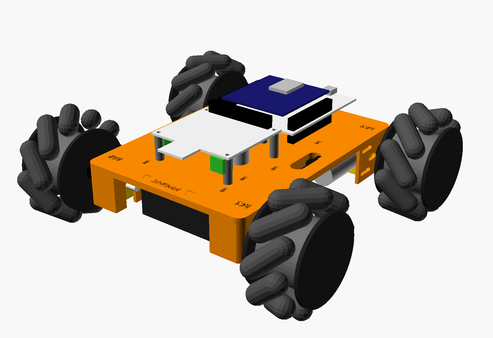
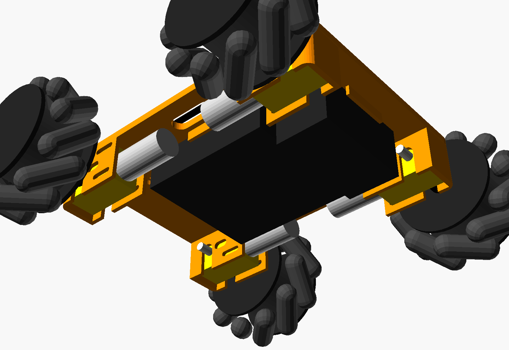
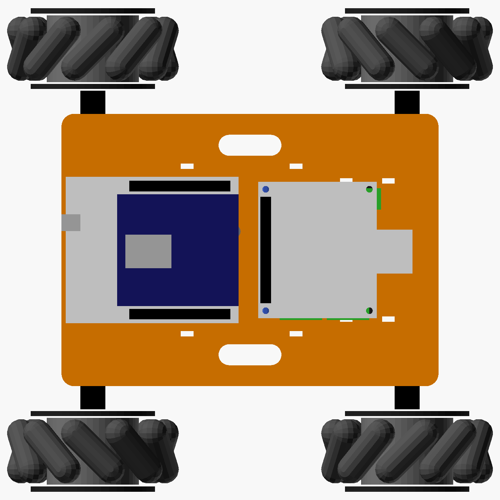

# v1 printed chassis: the bench rover with the parts on hand

A simple one-piece printed deck that replaces the red aluminium chassis for the current build. It carries only the parts we have today:

- NUCLEO-L073RZ with the X-NUCLEO-67W61M1 Wi-Fi shield (rear)
- X-STM32MP-RBT01 motor board (front)
- the 4 yellow TT gear motors and the 4 mecanum wheels from the red chassis
- the 4 × 18650 holder and the 2 × 2 AA holder, strapped under the deck

The rover is 230 mm long and 232 mm wide (150 mm wheelbase, 192 mm track). The deck top sits 56 mm above the ground and the lowest part (the AA holder) is 20 mm above it.



| Underneath | Top view (front = right) |
|:---:|:---:|
|  |  |

## Files

| File | What it is |
|:---|:---|
| `v1_print_chassis.scad` | The model. Every size is a setting at the top (OpenSCAD Customizer) |
| `stl/v1_deck.stl` | The deck, already upside down as it prints. Print 1 |
| `stl/v1_spacers.stl` | 4 × 12 mm spacers (Nucleo) and 4 × 18 mm spacers (RBT01). Print 1 set |
| `renders/` | The pictures on this page, plus `deck_as_printed.png` |

## Measure before printing

Values marked `[EST]` in the `.scad` file come from photos. Check them with calipers, change the number, and re-export. Nothing else needs editing.

| Setting | Default | What to measure |
|:---|:---|:---|
| `rbt_inset`, `rbt_size` | holes 58 × 49 mm apart | RBT01 corner holes, centre to centre. The board is a Raspberry Pi HAT outline (65 × 56.5 mm) |
| `b18` | 81 × 77 × 21 mm | 4 × 18650 holder: across the cells, along the cells, height |
| `aa` | 32 × 63 × 31 mm | 2 × 2 AA holder: width, length, height |
| `wheel_d`, `wheel_w` | 80 × 40 mm | Mecanum wheel. Only changes the ride height and the clearance |
| `hub_gap` | 14 mm | Gearbox face to the wheel's inner face, with the black coupler fitted |
| `tt_hole_dz` | 8.75 mm | The motor's 2 mounting holes: half their spacing (they sit above and below the shaft line) |

The Nucleo holes come from UM1724 fig. 5 and need no change. The motor bolt slots run 15–25 mm from the shaft, so the exact hole position along the motor doesn't matter.

## Printing

- PLA or PETG, 0.2 mm layers, 4 perimeters, 25 % infill, no supports.
- The STL is already upside down: the flat top of the deck goes on the bed and the motor pockets point up.
- Needs a bed of at least 190 × 140 mm. Expect roughly 100–120 g of filament (solid volume 126 cm³).
- The deck top has `FRONT`, two arrows and `M1`–`M4` engraved on it. M1–M4 are the firmware's motor numbers: M1 front-left, M2 front-right, M3 rear-left, M4 rear-right.

## Hardware

| Qty | Part | Used for |
|---:|:---|:---|
| 8 | M3 × 30 screw + nut | Motors, 2 each. The red chassis' long motor screws fit if they are M3 × 30 |
| 3 | M3 × 20 screw + nut | Nucleo, on the 12 mm spacers |
| 4 | M3 × 25 screw + nut | RBT01, on the 18 mm spacers (the board comes with 4 M3 nuts) |
| 4 | Zip tie, up to 5 mm wide, about 300 mm long | Battery holders, 2 each |
| a few | Small zip ties | Tidy the motor and battery leads |

## Assembly

1. **Motors.** Push each motor up into its pocket from below: shaft through the notch, motor can toward the middle of the deck. Put an M3 × 30 through the outer wall slot, the gearbox hole and the inner wall slot, with the head on the wheel side and the nut inside. Do the same for the second hole. If a motor has a small locating peg on its face, it sits in the short slot next to the shaft. Each motor goes in the pocket with its engraved number (M1 front-left, and so on).
2. **Motor leads.** Bring all 8 leads up through the two long side slots and solder them to the RBT01 as on the build sheet (`17_Rover_MotorDriver_WiFi_ST67W61/docs/rbt01a_sheet_a_motors_power.png`). Black lead → 2A / 2B, red lead → 1A / 1B.
3. **Batteries.** The 18650 holder goes open side up against the deck, so the cells can't drop out, between the lips behind the middle. The AA holder goes in front of it. Use 2 zip ties around each holder, through the slots beside it. Bring their leads up through the side slots.
4. **Nucleo.** Put it on the 12 mm spacers with the ST-LINK USB socket toward the back edge. Use M3 × 20 screws from below: the heads sit flush in the counterbores.
5. **RBT01.** Mount it underside-up (component side facing the deck) on the 18 mm spacers, with the 40-pin socket edge toward the Nucleo. The 40-pin socket and the motor solder joints then face up, so the 14 jumper wires plug straight in from above, as on sheet B (`rbt01a_sheet_b_logic_wires.png`). The holes are symmetric, so the same deck holes work either way up.
6. **Wheels.** Put each wheel back on the corner it came from on the red chassis. Then run the wheel-direction steps on the build sheet. If `STRAFE:40` twists the rover instead of sliding it, swap the two front wheels with each other and the two rear wheels with each other.

## Power: check the voltage before connecting

- The TT motors are 3–6 V parts. The firmware doesn't cap the PWM, so the motors see the full pack voltage.
- The RBT01 driver won't start below about 5.2 V.
- 4 × AA alkaline gives about 6 V fresh. That suits the motors but sags under load, so the driver can drop out as the cells run down.
- 4 × 18650 in series gives 14.8–16.8 V, too much for TT motors until the firmware caps the duty cycle. The holder also needs all 4 cells fitted to give any output.
- Meter the pack before connecting it to CN3.

## Re-exporting

OpenSCAD 2021.01 (the portable copy in `Downloads`) from Git Bash:

```bash
OS="/c/Users/choprasu/Downloads/OpenSCAD-2021.01-x86-32/openscad-2021.01/openscad.com"
"$OS" -o stl/v1_deck.stl    -D 'MODE="deck"'    v1_print_chassis.scad
"$OS" -o stl/v1_spacers.stl -D 'MODE="spacers"' v1_print_chassis.scad
"$OS" -o renders/assembly_front_left.png --imgsize=1600,1100 --colorscheme=Tomorrow --camera=430,330,300,0,0,35 -D 'MODE="assembly"' v1_print_chassis.scad
```

The console prints the rover size, the ground clearance, the board hole positions, and a `WARNING` line if a battery holder would hit a motor, a bolt or a shaft.
